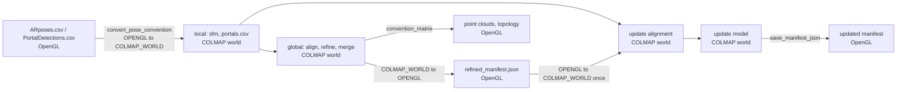

# Coordinate conventions

This document lists the coordinate convention used at each pipeline step and for each output file. It also lists the places where two conventions meet without a conversion between them.

Frames are named the way the Auki SDK names them: each one says which way its x, y and z axes point, its handedness and its units. All frames here are right-handed and in meters. `reconstruction/geometry/frames.py` declares the frames that code converts between. Every conversion goes through `auki_geometry`, the SDK's convention library (`labs/auki-geometry` in [auki-sdk](https://github.com/aukilabs/auki-sdk), pinned with the SDK rev the node uses).

## Frames

| Frame | x | y | z | Declared as | Used by |
|---|---|---|---|---|---|
| OpenGL | right | up | backward | `frames.OPENGL` (the SDK's `opengl` preset) | ARKit world (`ARposes.csv`, `PortalDetections.csv`); Domain portal poses (`portals.json`); `refined_manifest.json`; the OpenGL point clouds and topology meshes |
| COLMAP world | up | right | forward | `frames.COLMAP_WORLD` | The world of every COLMAP model the pipeline writes (`colmap_rec`, `sfm`, `refined_sfm_combined`) and of `portals.csv`. Gravity is -x. |
| COLMAP camera | right | down | forward | `frames.OPENCV_CAMERA` (the SDK's `ros_optical` preset) | Every camera in a COLMAP model: x right and y down in the image, z along the optical axis |
| DMT camera | down | right | backward | | The camera side of `ARposes.csv`, relative to the stored landscape frame. It is not ARKit's own camera frame (right, up, backward); the recorder app rotates it before writing. |
| QR marker | right | up | backward | `frames.OPENGL` | A marker's own frame as the DMT recorder and pnp-lab report it: x and y in the marker plane, z out of the printed face toward the viewer |
| Auki robot world | forward | left | up | Read from each session's registry; `frames.AUKI_ROBOT_WORLD` is what every session so far declares | `world` and `base_link` in an Auki capture (the SDK's `ros_body` preset) |
| Auki camera | right | down | forward | Read from the registry (`frames.OPENCV_CAMERA`) | Auki sensor optical frames. Same as the COLMAP camera. |
| Auki anchor | forward | up | right | `frames.AUKI_ANCHOR` | `qr_anchor_poses.csv` and `point_cloud_qr_anchored.ply` (Auki-session flow) |
| Auki anchor marker | forward | left | up | `frames.AUKI_ANCHOR_MARKER` | The marker frame `convert_qr0_to_auki` relabels from. The anchor origin is a floor marker, so this matches pnp-lab's face normal pointing up |

The DMT camera row was measured, not read from code. On the golden scan `2026-03-18_17-51-58`, the `ARposes.csv` camera poses, converted as the local stage converts them, agree with the refined COLMAP cameras to 0.59° median and 3.2° max over 601 frames. That agreement holds only if the camera axes in the file are (down, right, backward).

## Conversions

The SDK has three ways to change a pose's convention. They differ in which side of the pose they relabel. In pycolmap's `A_from_B`, B is the side the pose reads points from (the SDK calls it the source) and A the side it writes them to (the target).

| SDK function | Relabels | Example |
|---|---|---|
| `convert_pose_convention(pose, from, to)` | Both sides | A DMT pose: the world and the camera or marker change convention together |
| `convert_transform_target_convention(pose, from, to)` | The target (A) only | An Auki `world_from_camera`: the world changes convention, the camera keeps its own axes. Also pnp-lab's `camera_from_marker`: the camera changes, the marker keeps its own |
| `convert_transform_source_convention(pose, from, to)` | The source (B) only | A `world_from_camera` whose camera axes change while the world stays |

`convention_matrix(from, to)` gives the 4×4 matrix for points.

The DMT flows use one conversion, `frames.convert_pose_convention(position, quaternion, OPENGL, COLMAP_WORLD)` and its reverse. It swaps x and y and negates z on both sides of the pose, and applying it twice gives back the original pose. The quaternion it returns can be the negated one, which is the same rotation.

Relabelling both sides is right for DMT cameras because the DMT camera frame and the COLMAP camera frame differ by the same swap. For markers it relabels the marker's own axes too: in `portals.csv` a marker's x is the marker's up, y its right, and z points into the printed face. So a floor marker's z points down, which is why the DMT flat-portal check compares against `[-1, 0, 0]` (down in COLMAP world).

## Local refinement (DMT scan)

| Step | In | Code | Out |
|---|---|---|---|
| Read camera poses | `ARposes.csv`: `world_from_camera`, OpenGL world, DMT camera | `pipeline/local/refine.py:102` `convert_pose_convention(…, OPENGL, COLMAP_WORLD)` | COLMAP world, COLMAP camera |
| Read portal detections | `PortalDetections.csv`: `world_from_marker`, OpenGL world, QR marker | `io/portals.py:46`, same conversion | COLMAP world, relabelled marker |
| Triangulate, bundle-adjust | COLMAP world | `pipeline/local/triangulation.py`, `bundle_adjuster.py` | COLMAP world. The gauge stays the ARKit world's: within 0.2° of it on the golden scan |
| Portal world poses | Detections in camera space plus the refined cameras | `pipeline/local/qr.py:42` | COLMAP world |
| Snap near-floor portals flat | Portal z within 20° of `[-1, 0, 0]` | `pipeline/local/refine.py:207` → `geometry/pose.py:71` `rectify_portal_pose` | COLMAP world |
| Write | | `pipeline/local/refine.py:210`, `io/model.py` | `sfm/*.bin` and `portals.csv` in COLMAP world |

## Global refinement

| Step | In | Code | Out |
|---|---|---|---|
| Read scans | `sfm/` and `portals.csv` of each scan, each in its own COLMAP world | `pipeline/global_map/alignment.py:129` | |
| Domain origin | A floor marker at the origin, given in OpenGL | `pipeline/global_map/alignment.py:34` `convert_pose_convention(…, OPENGL, COLMAP_WORLD)` | `floor_origin_portal_pose`, COLMAP world |
| Place the first scan | Its first floor portal (`is_portal_almost_flat`), turned only about up (x) | `pipeline/global_map/alignment.py:75-92` | Scan in the domain frame, COLMAP world axes |
| Place later scans | `placed * scanned⁻¹` per shared portal, averaged | `pipeline/global_map/alignment.py` `calculate_alignment_transform` | Same |
| Refine and merge | COLMAP world | `pipeline/global_map/refine.py`, `merge.py` | `refined_sfm_combined`, COLMAP world |
| Manifest portals | COLMAP world, rectified | `output/manifest.py:188` `convert_pose_convention(…, COLMAP_WORLD, OPENGL)` | `refined_manifest.json`, OpenGL |
| Point cloud | `export_PLY` in COLMAP world | `entrypoints/global_map.py:153-156` → `output/pointcloud.py:71` `convention_matrix(COLMAP_WORLD, OPENGL)` | `RefinedPointCloud*.ply` and `.drc`, OpenGL |
| Topology | `RefinedPointCloud.ply` | `pipeline/topology/mesh.py:39` | `topology/*.obj`, `*.glb`, OpenGL |

Every alignment in global is computed and applied in COLMAP world.

## Update refinement

Alignment stays in COLMAP world. The manifest is converted into that frame once on the way in, and `save_manifest_json` is the one conversion back to OpenGL. A reference with no shared portal raises `NoOverlapException`. Placing the first scan of a domain is global refinement's job.

| Step | In | Code | Out |
|---|---|---|---|
| Read the reference map | `refined_sfm_combined` (COLMAP world) and `refined_manifest.json` portals (OpenGL) | `pipeline/update/update.py:190`, then `convert_pose_convention(…, OPENGL, COLMAP_WORLD)` at `:198` | Model and placed portals in COLMAP world |
| Read each new scan's portals | `portals.csv`, COLMAP world | `pipeline/update/update.py:130`, poses kept as read | COLMAP world |
| Alignment | Both portal sets in COLMAP world. A floor marker contributes yaw about up only | `pipeline/update/update.py:59` and `:212` | A COLMAP-world transform |
| Apply the alignment | The new scan's model, COLMAP world | `pipeline/update/update.py:226` | COLMAP world |
| Prune, merge | COLMAP world | `pipeline/update/carving.py`, `merge.py` | `refined_sfm_combined`, COLMAP world |
| Manifest portals | COLMAP world | `pipeline/update/update.py:279` passes them to `save_manifest_json`, which converts once at `output/manifest.py:188` | `refined_manifest.json`, OpenGL |
| Point cloud | COLMAP world | `pipeline/update/update.py:294` → `output/pointcloud.py:71` `convention_matrix(COLMAP_WORLD, OPENGL)` | `RefinedPointCloud*.ply`, OpenGL |

## Local refinement (Auki session)

`python3 -m reconstruction local-auki-session`.

| Step | In | Code | Out |
|---|---|---|---|
| Robot world convention | The session's registry (`world` → `base_link` pose log) | `io/auki_session.py` `_read_from_frame` | The session's declared world (Auki robot world so far) |
| Camera poses | `world_from_camera`: the session's world and the Auki camera | `geometry/auki_conventions.py` `convert_to_colmap_world`: `convert_transform_target_convention(…, session world, COLMAP_WORLD)` | COLMAP world, camera axes unchanged (already the COLMAP camera) |
| QR poses from pnp-lab | `camera_from_marker` with the camera in OpenGL axes | `pipeline/auki_session/qr.py` `_corners_to_camera_space_pose`: `convert_transform_target_convention(…, OPENGL, OPENCV_CAMERA)` | COLMAP camera, marker axes unchanged (QR marker) |
| Snap near-floor portals flat | Marker z within 20° of `[1, 0, 0]` (`_QR_UP_AXIS`): pnp-lab's marker z points out of the face, so up for a floor marker | `pipeline/auki_session/qr.py` `process_auki_qr` | COLMAP world, QR marker |
| `portals.csv` | Right-multiplied by `_DOMAIN_PORTAL_FRAME_RELABEL`, so the marker axes match the DMT `portals.csv` | `pipeline/auki_session/qr.py` `process_auki_qr` | COLMAP world, relabelled marker, as in the DMT flow |
| QR-anchored outputs | Re-origined at one marker. The caller passes `--qr_origin_id`, or the marker with the lowest cross-detection deviation is used. Capture policy puts that marker on the floor | `geometry/auki_conventions.py` `convert_colmap_pose_to_qr_origin_auki` → `convert_qr0_to_auki` | Auki anchor (`qr_anchor_poses.csv`, `point_cloud_qr_anchored.ply`) |

Both flows call `rectify_portal_pose`. DMT uses the default axis `[-1, 0, 0]`, the floor normal after the marker axes have been relabelled. Auki passes `_QR_UP_AXIS` `[1, 0, 0]` before `_DOMAIN_PORTAL_FRAME_RELABEL`, while pnp-lab's z still points out of the face. A ceiling or wall marker is left as detected: its normal is outside 20° of that floor axis, so the check does not snap it. After the relabel, `portals.csv` is the shared convention, and global and update read it with the DMT axis.

## Output files

| File | Frame |
|---|---|
| `refined/local/<scan>/sfm/*.bin`, `colmap_rec/*.bin` | COLMAP world, COLMAP cameras |
| `refined/local/<scan>/sfm/portals.csv` | COLMAP world, relabelled marker axes |
| `refined/global/refined_sfm_combined/*.bin`, `refined/update/refined_sfm_combined/*.bin` | COLMAP world (the domain frame) |
| `refined_manifest.json` portals | OpenGL, QR marker axes |
| `RefinedPointCloud.ply`, `RefinedPointCloudReduced.ply`, `RefinedPointCloudFloat.ply`, `RefinedPointCloud.ply.drc` | OpenGL |
| `topology/*.obj`, `topology/*.glb` | OpenGL |
| `qr_anchor_poses.csv`, `point_cloud_qr_anchored.ply` (Auki session) | Auki anchor, origin at one marker |

## Findings

Closed.

1. Update alignment is computed and applied in COLMAP world (`pipeline/update/update.py`). `save_manifest_json` is the one conversion back to OpenGL.
2. The update manifest is converted once. `portal_r` goes to `save_manifest_json`, which converts COLMAP world to OpenGL.
3. Update has no first-chunk branch. A reference with no shared portal raises `NoOverlapException`. Global refinement still places its first scan on a floor portal.
4. One flat-portal function, `rectify_portal_pose`. The axis is `[1, 0, 0]` before the Auki marker relabel and `[-1, 0, 0]` after it. See the Auki session section.
5. The anchor origin is a floor marker by capture policy, so `convert_qr0_to_auki` matches pnp-lab's face normal with up.
6. The occlusion step reorders y and z (`y_z_swap` in `pipeline/occlusion/occlusion_box.py`). The step stays disabled.
